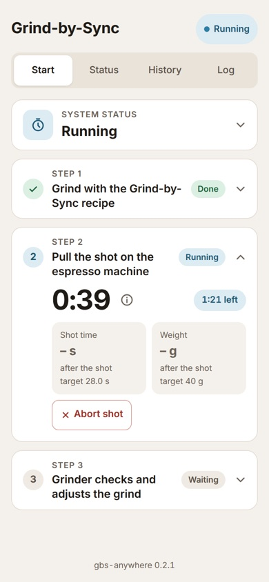
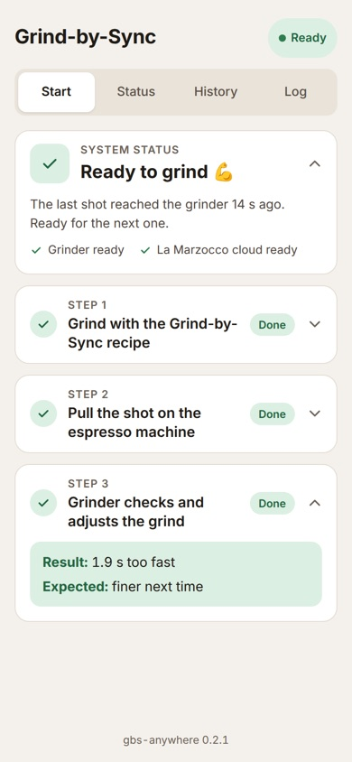
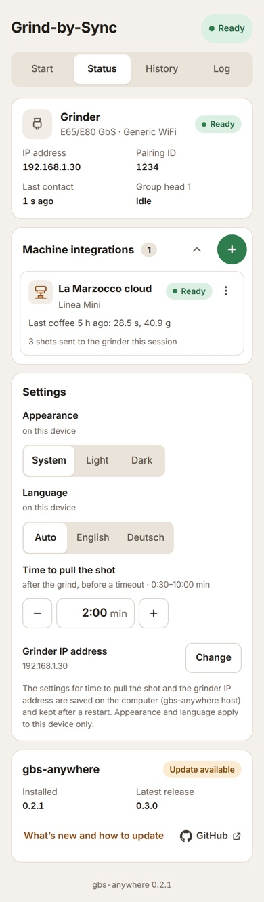
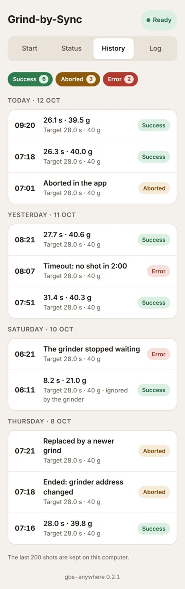

# gbs-anywhere guide

A walk-through from first setup to daily use, with fixes for the problems
people run into. The [README](README.md) has the reference: every flag,
every API call.

- [1. What it is for](#1-what-it-is-for)
- [2. Setup](#2-setup)
- [3. Daily use](#3-daily-use)
- [4. Upgrading from 0.2.x](#4-upgrading-from-02x)
- [5. Troubleshooting](#5-troubleshooting)

## 1. What it is for

Mahlkönig's Grind-by-Sync (GbS) grinders dial themselves in. After every
shot the grinder compares the shot time with the recipe's target and turns
its grind setting finer or coarser. To do that it has to learn each shot's
time and weight from the espresso machine, which only a few connected
machines can tell it.

gbs-anywhere stands in for that machine. It runs on any computer in your
home network that is always on (a NAS, a Raspberry Pi, a Mac mini, a PC) and
passes each shot to the grinder:

1. You grind with a GbS recipe. gbs-anywhere learns that a shot is coming.
2. You pull the shot on your own espresso machine.
3. Its time and weight reach gbs-anywhere: you type them into the app on
   your phone, or an integration reports them by itself (for example the
   La Marzocco cloud for a machine with Brew by Weight).
4. gbs-anywhere passes them to the grinder, which adjusts for the next shot.

It works with the E64 WS and with the E65/E80 GbS models (E65W, E65T, E80W,
E80T). The two families connect differently, but you use the app the same
way.

**What you need**

- The grinder on your home WiFi (the E64 WS only uses 2.4 GHz).
- A computer on the same network that stays on, with Docker (or Rust, to
  build from source).
- A phone or computer with a browser for the app.
- A timer and a scale, or an integration that measures for you.

## 2. Setup

### 2.1 Fixed addresses

Give the computer running gbs-anywhere a fixed IP address, for example a
DHCP reservation in your router. For an E65/E80 GbS, do the same for the
grinder: set it in the router, and if you also set it on the grinder, use
the same address in both places. When an address changes, the link breaks
until you update it.

### 2.2 Start gbs-anywhere

With Docker:

```sh
docker run -d --name gbs-anywhere --restart unless-stopped \
  -p 80:80 -v gbs-anywhere:/data ghcr.io/skamba/gbs-anywhere
```

Keep the `gbs-anywhere` volume: it holds what you set up in the app, the
pairing with an E65/E80 GbS and the shot history. `--restart unless-stopped`
brings it back after the computer restarts.

Open `http://<the computer's IP>/` on your phone, for example
`http://192.168.1.20/`, and add it to your home screen.

### 2.3 Connect an E64 WS

The E64 WS asks gbs-anywhere for the machine's state, so it must reach the
computer on port 80.

1. On the grinder: **Settings → Connectivity → Machine To Machine → Enable
   Xenia**. The grinder calls the machine "Xenia"; gbs-anywhere answers as
   one.
2. **Configuration**: enter the computer's IP address by hand (the scan will
   not find it).
3. Within a few seconds the status at the top right of the app turns
   **Ready**, and **System status** on the Start tab says **Ready to
   grind 💪**; tap it to see **Grinder connected**.

### 2.4 Pair an E65/E80 GbS

gbs-anywhere connects to these grinders, not the other way round: it needs
the grinder's address, and the grinder needs nothing from the computer.

1. On the grinder: **Settings → Connectivity → Machine To Machine**, enable
   **Generic WiFi** and leave the other machines off. Set **Grouphead
   Selection** to **Grouphead 1** (or **All**). GbS only learns from the
   selected group, and gbs-anywhere is a one-group machine.
2. In the app: **Status → Settings → Grinder IP address → Change**, enter the
   grinder's address (shown in the grinder's WiFi settings, for example
   `192.168.1.30`) and save. (Or start gbs-anywhere with
   `-e GRINDER_HOST=192.168.1.30`.) The app now shows a pairing code on the
   Start tab and in the grinder card under Status.
3. On the grinder: **Generic WiFi → Configuration → Start Pairing**.
   **gbs-anywhere** appears under **Available devices** with the same code.
   Select it and tap **Accept Pairing**.
4. The Generic WiFi entry is now called **gbs-anywhere**. Its **Diagnosis**
   shows the activity status as on and group 1 as idle. In the app, the
   grinder shows **Ready** under Status.

The pairing is saved, so restarts and a new grinder address need no new
pairing.

### 2.5 Set up the recipe on the grinder

Open the recipe's menu, turn on **Enable GbS**, and set:

- **Brew Time**: the target shot time, for example 28 s.
- **Brew Weight**: the target weight in the cup, for example 40 g.
- **GbS start DD**: the grind setting to start from.

Worth setting on the grinder as well:

- **Settings → GbS Brew Time Tolerance** (Off, Small, Medium, Large): how
  close to the target time a shot must be for the grinder to count it as
  correct.
- **Disc Distance lower limit**, if your grinder offers it (see its manual;
  it may sit in the service settings): the finest setting the grinder may
  choose. A limit just below your usual setting keeps one odd shot from
  making the next one choke. Change it when you change beans.

### 2.6 Add an integration (optional)

Typing the time and weight on your phone needs no setup. To have them
reported for you, open **Status → Machine integrations** and tap the green
**+**:

- **La Marzocco cloud**: reads each shot from a La Marzocco machine's coffee
  log; with Brew by Weight, the weight is the machine's. Needs the account
  you use in the La Marzocco app, and the machine online.
- **Half Decent Scale**: reads time and weight from the scale over WiFi.

Details: [La Marzocco](src/integration/la_marzocco/README.md),
[Half Decent Scale](src/integration/half_decent/README.md).

### 2.7 Settings in the app

Under **Status → Settings**:

- **Time to pull the shot**: how long after the grind gbs-anywhere keeps the
  grinder waiting for the shot's numbers, from 0:30 to 10:00 minutes. Use
  **−** and **+** (15 seconds a tap), or tap the time and type it: `2:30`,
  `2.5` (minutes) or `150` (seconds). Without a shot by then, the grinder is
  told the shot was cancelled and changes nothing.
  The time runs until the numbers arrive, so allow for tamping, the shot
  itself and, with an integration, the few seconds it takes to report.
- **Grinder IP address**: see [2.4](#24-pair-an-e65e80-gbs).
- **Appearance**: System, Light or Dark, kept on each device.
- **Language**: Auto (the device's language), English or Deutsch, kept on
  each device. Error messages, log lines and the texts of an integration the
  app has no wording for stay in English.

The time to pull the shot and the grinder IP address are saved on the
computer running gbs-anywhere, kept after a restart, and win over the
matching start setting (flag or environment variable) from then on.
Appearance and language are kept on each phone or computer.

## 3. Daily use

The app has four tabs.

### Start: the current shot



**System status** says whether everything is ready; tap it for the details.
When something keeps a shot from starting, such as **No grinder
connected**, it opens by itself, says why in plain words and step 1 shows
**Blocked**. Below it are the three steps of a shot. The step that is
running, or the one that failed, opens by itself.

1. **Grind with the Grind-by-Sync recipe.** On an E65/E80 GbS, gbs-anywhere
   notices the grind by itself. On an E64 WS, press the grinder's knob when it
   asks, and start the shot on the machine right away.
2. **Pull the shot.** The timer counts from the grind, with the time that is
   left. With an integration the shot is reported by itself. Without one,
   time the shot from pump start, weigh the cup and type both in, then tap
   **Send**. Without a weight, the recipe's weight is sent. **Abort shot**
   tells the grinder to skip this one.
3. **The grinder checks and adjusts.** The result says whether the shot was
   too fast, too slow or on target, and what to expect next time. That is a
   guess: the grinder decides by itself, and may count a shot near the
   target as correct.



Good to know:

- Grinding again before pulling the shot is fine: the newer grind is the
  shot, and the grinder is told the older one was cancelled.
- The grinder ignores shots of 10 s or less and over 80 s.
- After the grinder changes its setting, the next shot or two may still
  contain coffee ground at the old setting (it stays inside the grinder).
  Judge the change after that, not on the very next cup.

### Status: grinder, integrations, settings, version



- **Grinder**: its address, pairing ID, last contact and what it is doing.
- **Machine integrations**: each one with its state and last shot. The ⋮
  menu has **Edit** and **Delete**.
- **Settings**: see [2.7](#27-settings-in-the-app).
- **gbs-anywhere**: the installed version and whether a newer one is out.

### History: the last 200 shots



Each shot the grinder asked for, with its time and weight, the target, and
how it ended: **Success**, **Aborted** (by you, or replaced by a newer grind)
or **Error** (for example no shot in time). Tap the chips at the top to hide
or show each kind.

### Log: what gbs-anywhere is doing

The last 1,000 lines, live. **Follow** keeps the newest line in view,
**Warnings only** hides the routine lines. **Copy** takes the last
60 minutes (up to 500 lines) and **Download** the whole log as a text file,
both with IP addresses replaced, ready for a bug report.

## 4. Upgrading from 0.2.x

The version after 0.2.1 brings the new app and the E65/E80 GbS support.
Everything you set up is kept: integrations added in the app and the
recipe on the grinder.

**With Docker**

1. Note how you started the container, including its environment variables
   (`docker inspect gbs-anywhere` shows them).
2. Get the new image and start the container again with the same command and
   the same volume. If your command names a version (for example `:0.2`),
   drop it or use the new one:

   ```sh
   docker pull ghcr.io/skamba/gbs-anywhere
   docker stop gbs-anywhere && docker rm gbs-anywhere
   docker run -d --name gbs-anywhere --restart unless-stopped \
     -p 80:80 -v gbs-anywhere:/data ghcr.io/skamba/gbs-anywhere
   ```

   (add your `-e ...` options and flags as before)
3. Reload the app on your phone. The tabs replace the single page; the **+**
   for integrations is now under **Status → Machine integrations**.

**From source**: `git pull`, `cargo build --release`, and start it with the
same `--config` file as before.

**After the upgrade (optional)**

- **Integrations set with flags or environment variables** (for example
  `LM_USERNAME`/`LM_PASSWORD`) show "From the start settings". To change them
  in the app, open the ⋮ menu, tap **Edit**, and confirm **Move into the
  app**. Their settings, password included, are taken over, so there is
  nothing to type again. (This needs a settings file: Docker has one; from
  source, start gbs-anywhere with `--config`.) From the next start on the old variables are
  ignored, and you can remove them from your `docker run` command or
  environment file whenever it suits you.
- **The shot window** now shows in the app as **Time to pull the shot**. If
  you set `--brew-timeout-s`, that value stays until you pick another one in
  the app.
- **The history** starts with the first shot after the upgrade.
- **The update check** asks GitHub once a day for the latest release. Turn it
  off with `-e UPDATE_CHECK=off` if you prefer.

**Going back to 0.2.1** (E64 WS only; 0.2.1 cannot pair with an E65/E80
GbS) works with the same volume, with two things to know: 0.2.1 rewrites the
settings file when it starts, which drops the settings changed in the app
and forgets which integrations were moved into the app. An integration you
moved runs twice there if its old variables are still set (remove one of
them), and again after the next upgrade if you put the variables back.

## 5. Troubleshooting

When something looks wrong, look at **Status** and the **Log** tab first:
most problems are spelled out there.

### Setup and pairing

**The E65/E80 GbS has no "Xenia" option.**
That option is the E64 WS's. Use **Generic WiFi**, as in
[2.4](#24-pair-an-e65e80-gbs).

**gbs-anywhere does not appear under Available devices, or pairing times
out.**
- Check that the app shows a pairing code. If it does not, the grinder
  address is missing or wrong: **Status → Settings → Grinder IP address**.
- Computer and grinder must be on the same network. Guest networks and
  separated VLANs block the connection (gbs-anywhere connects to the grinder
  on port 30001).
- If you enabled Generic WiFi after starting gbs-anywhere, give it up to a
  minute, then tap **Start Pairing** again. The code may change; the app
  always shows the current one.

**The grinder restarted right after Accept Pairing, and the app asks for a
pairing ID.**
The pairing was made, but gbs-anywhere did not learn its ID. On the
grinder, open the gbs-anywhere entry under Generic WiFi: the **Pairing ID**
is the first line of **Configuration**, and also under **Diagnosis** after
the serial number. Type it into the app and tap **Use this pairing ID**.

**The grinder's Diagnosis shows the activity status as off, or group 1 as
unknown.**
gbs-anywhere is not reaching the grinder. Check that it runs (the app
opens), that the grinder address under Status is right, and the Log tab for
"not reachable".

**The pairing was cleared on the grinder.**
gbs-anywhere notices and asks to pair again: accept it on the grinder as in
[2.4](#24-pair-an-e65e80-gbs).

**The grinder got a new IP address.**
Enter the new one under **Status → Settings → Grinder IP address**. The
pairing is kept. Set up a DHCP reservation so it does not happen again.

### Shots

**The shot was reported, but the grinder did not change its setting.**
- Is **Grouphead Selection** on the grinder **Grouphead 1** or **All**?
- Is GbS on in the recipe (**Enable GbS**)?
- Was the shot close to the target? The grinder may count it as correct
  (**GbS Brew Time Tolerance**) and change little or nothing.
- Shots of 10 s or less and over 80 s are ignored, as are aborted and
  cancelled ones. The History tab shows how each shot ended; with an E65/E80
  GbS the Log shows "grinder: sent …" for every shot that reached it.

**"Timeout: no shot within 2:00".**
The shot's numbers did not arrive in time, so the grinder was told to skip
it. Raise **Time to pull the shot** under Status → Settings. With an
integration, the time also has to cover the few seconds it needs to report.

**The grinder adjusts too much: one shot is too fast, the next one chokes.**
GbS can change the setting noticeably after a single shot, and the change
only shows fully once the coffee left inside the grinder has been
used up, often after two or three doses.
- Set the **Disc Distance lower limit** just below your usual setting, so
  that a jump can never go far enough to choke the shot.
- Try a **GbS Brew Time Tolerance** (for example **Medium**), so that the
  grinder counts shots close to the target as correct.
- Avoid changing the grind setting by hand while GbS learns. If you do, purge
  a little coffee afterwards, so the next shot is ground at the new setting.
- Judge a change after one or two shots, not on the first.

**The La Marzocco cloud does not report a shot.**
- Its card under Status shows the reason (for example a failed login). Edit
  it from the ⋮ menu.
- The machine must be online in the La Marzocco app.
- The shot shows up a few seconds after it ends. Until then, or if it never
  does, type it in on the Start tab.

**An integration shows "From the start settings" and cannot be edited.**
It was set with flags or environment variables. Use **Edit → Move into the
app** (see [4](#4-upgrading-from-02x); needs a settings file).

### Running gbs-anywhere

**The grinder is off or in standby (for example on a schedule or a smart
plug).**
The app shows **No grinder connected** and "The grinder does not answer. Is
it switched on?". Nothing to do: gbs-anywhere reconnects by itself as soon as
the grinder answers again. The log says once that the grinder is not
reachable and again when it is back. If the grinder is on and the app still
says so, check the grinder IP address under **Status → Settings**.

**The app says "The grinder answers, but the connection is not working right
now".**
The grinder is reachable but refuses or does not understand the requests.
The last error is shown below that line; the Log tab has the details.
gbs-anywhere keeps trying. If it does not clear up within a few minutes,
restart the grinder; if that does not help either, see **Still stuck?**
below.

**Port 80 is taken on the computer.**
For an E65/E80 GbS, any port works for the app, for example `-p 8080:80`
(then open `http://<IP>:8080/`). The E64 WS needs port 80.

**gbs-anywhere started from a terminal on a Mac cannot reach the grinder
("No route to host").**
macOS can deny local-network access to programs that keep running in the
background after the terminal or SSH session ends. Run gbs-anywhere in
Docker, or allow your terminal app under **System Settings → Privacy &
Security → Local Network**.

**Copy in the Log tab does nothing.**
Browsers limit the clipboard on plain `http://` pages. The app then shows the
text so you can select and copy it by hand; **Download** always works.

**Still stuck?**
Copy the log (Log tab → Copy) and open an issue on
[GitHub](https://github.com/Skamba/gbs-anywhere/issues) with what you did,
what you expected and what happened.
